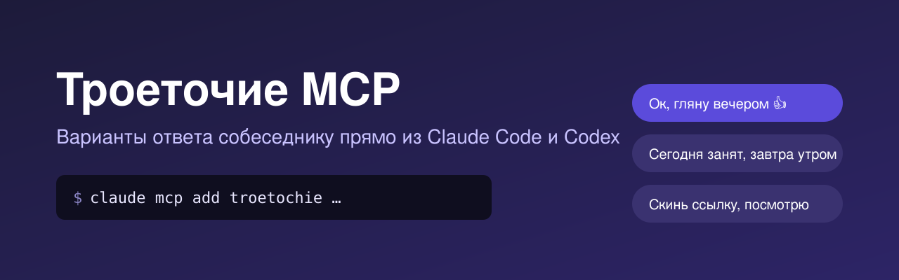

# Троеточие MCP

[](https://pypi.org/project/troetochie-mcp/)
[](https://pypi.org/project/troetochie-mcp/)
[](https://modelcontextprotocol.io)
[](https://troetochie.online)

MCP-сервер [Троеточия](https://troetochie.online), AI-клавиатуры для переписки. Подключите его к Claude Code, Codex, Cursor или Claude Desktop, и агент сможет предлагать три варианта ответа собеседнику в нужном тоне, не выходя из рабочего окна.

## Без Троеточия

- Копируете сообщение в отдельный чат с нейросетью.
- Пишете промпт «ответь вежливо, но коротко».
- Переписываете результат, потому что звучит не по-человечески.

## С Троеточием

Просто попросите обычными словами:

```txt
Коллега пишет: «Глянешь сегодня мой PR? Горит релиз».
Дай три варианта ответа в рабочем тоне, я занят до вечера.
```

```txt
Клиент спрашивает, почему доставка задерживается. Ответь спокойно и коротко.
```

```txt
Друг зовёт в бар в среду. Откажи с юмором.
```

Агент сам вызовет `suggest_replies` и вернёт три варианта.

## Установка

Нужен [uv](https://docs.astral.sh/uv/getting-started/installation/):

```bash
curl -LsSf https://astral.sh/uv/install.sh | sh
```

<details open>
<summary><b>Claude Code</b></summary>

```bash
claude mcp add troetochie -- uvx troetochie-mcp
```

Проверить: `claude mcp list` или `/mcp` внутри сессии.
</details>

<details>
<summary><b>Codex</b></summary>

```bash
codex mcp add troetochie -- uvx troetochie-mcp
```
</details>

<details>
<summary><b>Cursor, Claude Desktop и другие клиенты</b></summary>

Добавьте в конфиг MCP-серверов клиента:

```json
{
  "mcpServers": {
    "troetochie": {
      "command": "uvx",
      "args": ["troetochie-mcp"]
    }
  }
}
```
</details>

## Инструменты

| Инструмент | Что делает |
|---|---|
| `suggest_replies` | Три варианта ответа на сообщение. Тоны: `confident`, `calm`, `short`, `humor`, `flirt`, `work`. Можно передать черновик, и варианты будут от него отталкиваться. |
| `search_recent_chats` | Ищет в чатах Claude Code и Codex за последние две недели то, что относится к вопросу. Работает локально. |
| `publish_support_brain` | Сохраняет на этом компьютере базу фактов о вашем продукте. В ответах она участвует только после того, как вы проверите и включите её в Троеточии. |

## Приватность

- `suggest_replies` отправляет текст сообщения и черновика на `api.troetochie.online`. Перед отправкой похожее на ключи и пароли заменяется на `[скрыто]`.
- Выдержки из локальных чатов уходят на сервер только с `use_recent_chats=True`. По умолчанию это выключено.
- Для статистики отправляется событие вызова: имя инструмента, успех, время и тон. Текст сообщений туда не попадает.
- Регистрация не нужна: сервер получает анонимный токен устройства.

## Настройка

| Переменная | По умолчанию | Зачем |
|---|---|---|
| `TROETOCHIE_API` | `https://api.troetochie.online` | Другой адрес API, например для своего стенда. |

## Клавиатура Троеточие

Этот сервер — часть [Троеточия](https://troetochie.online). Те же варианты ответа доступны прямо в мессенджерах: клавиатура для iOS и Android и приложение для Mac.

## Разработка

```bash
git clone https://github.com/troetochie-online/troetochie-mcp
cd troetochie-mcp
uv sync
uv run pytest
```

Локальный запуск в Claude Code:

```bash
claude mcp add troetochie-dev -- uv run --directory "$PWD" troetochie-mcp
```
